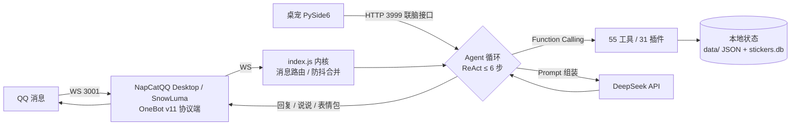

# Momo（大肥鱼）

> 一个有记忆、有情绪、会主动做事的 QQ 桌宠智能体 · 长期个人项目 · Node.js 零依赖

Momo 是一只住在 Windows 桌面的蓝色小鲸鱼女仆，通过 OneBot v11 协议接入 QQ。她不是问答机器人：她有分层记忆、情绪状态、生活预算、每日心流与主动行为，还有一套可热重载的插件平台和受限的自我进化层。桌面形象（PySide6 桌宠）通过本地"联脑"接口与她共用同一个大脑。

## 特性一览

- **智能体对话**：原生 Function Calling + 最多 6 步 ReAct 循环；55 个工具、24 个命令、31 个插件（聊天、联网搜索、提醒、待办、天气、QQ 空间、截图、找文件、语音、表情包……）
- **分层记忆**：会话历史 / 7 天短期记忆 / 长期记忆（关键词 2-gram 检索 + 时间衰减），私聊与群聊记忆互通，长对话滚动摘要防失忆
- **情绪系统**：15 种离散情绪 + 惯性与冷却、心情数值、好感度，全部注入提示词并真实影响语气
- **主动行为三层**：1 秒心跳（免费状态更新）→ 60 秒空闲脉冲（不花 token 记节奏）→ 10 分钟心流（感知 → 判断 → 执行，按"想做事的冲动"与预算决定是否行动），另有早安晚安、沉默搭话、静默准备池
- **表情包语义库**：SQLite 存储 100+ 张表情的语义（情绪 / 场景 / 风险 / 7 态生命周期：observed → verified → …），发图后回注"上一张"指针，支持主人在聊天里教学
- **自我进化层**：成长记忆（self/identity.json）、每日反思、技能规则（self/skills.json）、受限自改进提案（需主人批准）
- **工程保障**：每日生活费预算分级（钱不够自动降级能力）、操作留痕日志（谁要求、做了什么）、崩溃自愈、断线重连、漏消息补回

## 架构



三层架构：**内核层**（index.js：消息接入、agent 循环、数据、预算、调度）→ **插件层**（plugins/*.js：全部功能，只通过 ctx 通信，可热重载）→ **进化层**（evolution.js + self/：内省、反思、技能规则）。

## 目录结构

```
Momo/
├── index.js              # 内核（~3400 行）：路由 / agent 循环 / 记忆 / 情绪 / 心流 / 预算
├── plugin-host.js        # 插件宿主：加载器 / ctx / 钩子 / 工具与命令注册表
├── sticker-store.js      # 表情包语义库（node:sqlite）
├── check.js              # 启动自检（语法 + 配置 + 插件结构）
├── config.example.json   # 配置模板（复制为 config.json 后填写）
├── plugins/              # 31 个功能插件
├── self/                 # 自我进化层（运行时生成，仓库内为模板）
├── stickers/             # 表情包图片
├── test/                 # 35 个测试文件（纯 node 断言，全部跑一遍约 10 秒）
├── docs/                 # 架构、开发约定、决策记录、愿景、论文参考
├── supervise.ps1         # 守护进程（崩溃自动重启）
└── read_pet_key.py       # 从 Windows 凭据管理器读 API Key 的辅助脚本
```

## 快速开始

1. 需要 **Node.js 22+**（当前用 24）、Windows（部分能力依赖 PowerShell）
2. 把 `config.example.json` 复制为 `config.json`，填写你的 QQ 号、OneBot 协议端地址（如 NapCatQQ 的 SnowLuma 组件）
3. 新建 `.env`：`DEEPSEEK_API_KEY=sk-xxx`（联网搜索用博查时再加 `BOCHA_API_KEY=xxx`）
4. 运行：`node index.js`（长期运行建议 `supervise.ps1`，崩溃自动拉起）

## 设计要点（为什么这么做）

- **零 npm 依赖**：只用 Node 内置模块 + `node:sqlite`。单人长期维护的项目，依赖面越小越稳
- **Prompt 前缀缓存友好**：稳定前缀在前（人设 / 风格 / 处境），高频变化的动态上下文全部放最后，最大化命中缓存、省 token
- **插件三层架构**：插件之间不直接 require，一律走 `ctx.getApi()`；插件热重载（改文件 400ms 自动生效）
- **生活费预算**：每日 ¥2，按余额把能力分档（宽裕 → 只剩点钱），穷了自动降级为只读工具
- **版本纪律**：`BASE_VERSION` + CHANGELOG + git tag；回滚用 `git checkout v<旧版本> -- 文件`

## 踩坑记录（精选）

1. **"她不知道自己发的是哪张表情包"** → 发图后把「上一张」指针回注进下一轮上下文（`stickerRefCtx`）+ 表情包语义库，用户说"这张"时她知道指哪张
2. **长对话失忆** → 超过 40 轮自动滚动摘要（把最早一段压缩成 1~3 句，与旧摘要合并）
3. **完整句子台词被逐字复读** → 系统提示词只写「事实点」不写完整句子，并要求"用自己的话、别背"
4. **搜索返回摘要不够用** → 双引擎（博查 API / 百度解析）+ 失败自动降级，详见 docs/roadmap.md

## 数据与隐私声明

- `data/`（聊天记录、记忆、情绪等运行时数据）**不进版本库**，本仓库不含任何真实数据
- 本仓库**无任何密钥**：API Key 从 Windows 凭据管理器（read_pet_key.py）或 `.env` 读取
- `self/` 下身份、反思、日记均为运行时生成，仓库内仅保留模板与可编辑的技能规则
- 仅供学习交流使用，请遵守相关平台的使用规范

## 免责声明

本项目**仅供个人学习与技术交流使用**，不得用于任何商业用途或对外提供服务。项目基于 OneBot v11 标准接口与第三方协议端（如 NapCatQQ）对接，请自行遵守相关平台的服务条款与所在地法律法规；因使用第三方协议端产生的账号风险（如风控、封号）由使用者自行承担。本仓库不含任何协议端实现代码、密钥或真实用户数据。

## License

[MIT](LICENSE) © 2026 tishencainiao
